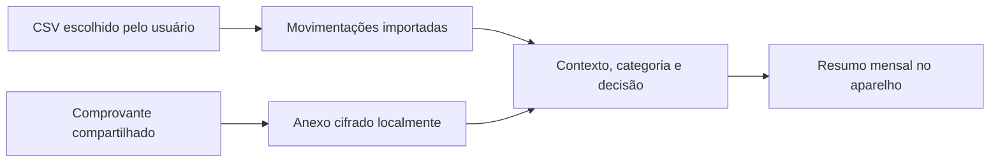

<div align="center">
  
  <h1>Finanças Conscientes</h1>
  <p><strong>Seu dinheiro, com contexto — sem culpa e sem depender de notificações bancárias.</strong></p>

  
  
  
  
</div>

<br />

O **Finanças Conscientes** é um aplicativo Android experimental para registrar o contexto dos gastos, organizar comprovantes e entender os próprios padrões financeiros. O foco é uma rotina simples e sem julgamento: importar as movimentações, explicar o que cada gasto significou e acompanhar os resultados.

> **Estado do projeto:** `0.6.5-experimental`. O código-fonte é público, mas o aplicativo continua experimental e não está pronto para uso financeiro em produção.

## O que você pode fazer

| Recurso | Como funciona |
|---|---|
| Importar extrato PicPay | Lê o CSV escolhido pelo usuário e usa as movimentações como referência para os totais importados. |
| Registrar contexto | Associa uma saída a “o que foi”, “onde foi”, categoria e decisão — inclusive opções personalizadas. |
| Guardar comprovantes | Recebe um PDF ou imagem compartilhado com o app e mantém o anexo cifrado no armazenamento privado do Android. |
| Ver resultados | Resume saídas, orçamento, categorias, decisões e maiores gastos; distingue itens pendentes de despesas classificadas. |
| Personalizar | Permite manter categorias, cores e decisões adequadas à realidade de cada pessoa. |
| Lembretes opcionais | Pode lembrar você ao abrir o PicPay. O lembrete é local e comportamental; **não detecta se um Pix foi concluído**. |
| Escolher aparência | Oferece tema claro, escuro ou sincronizado com o sistema. |

### Fluxo de dados



O CSV e o comprovante têm papéis diferentes: o extrato importa movimentações; o comprovante dá suporte a um registro manual. O app confere o formato e a integridade do arquivo, mas **não autentica o emissor nem interpreta automaticamente o comprovante como Pix**. Possíveis duplicidades ficam para revisão antes de qualquer vínculo.

## Privacidade por desenho

- A versão principal não declara permissão de Internet nem envia movimentações para um servidor.
- O estado financeiro e os comprovantes são cifrados localmente com AES-GCM e chaves do Android Keystore.
- CSVs, APKs, configurações locais e arquivos de chaves estão fora do controle do Git.
- O monitor opcional do PicPay requer consentimento e acesso de uso do Android. Ele observa localmente apenas a abertura do aplicativo; não lê tela, notificações bancárias ou credenciais.
- O app não integra com Open Finance, não acessa senha/PIN e não substitui o extrato como fonte das movimentações importadas.

Veja o [modelo de segurança e privacidade](docs/security/SECURITY-AND-PRIVACY.md) e as [decisões de arquitetura](docs/adr/).

## Começar a desenvolver

### Requisitos

- Android Studio compatível com Android Gradle Plugin `9.4.1`.
- JDK `17`.
- Android SDK Platform `37` e Build Tools `36.0.0`.
- Para validar no aparelho: Android `8.0` (API 26) ou superior.

Abra `repositories/app-android/` no Android Studio e aguarde a sincronização do Gradle. O aplicativo principal fica no módulo `app-v2`.

No Windows/PowerShell:

```powershell
cd repositories/app-android
.\gradlew.bat :app-v2:testDebugUnitTest :app-v2:lintDebug :app-v2:assembleDebug
```

No macOS/Linux:

```bash
cd repositories/app-android
./gradlew :app-v2:testDebugUnitTest :app-v2:lintDebug :app-v2:assembleDebug
```

O APK de desenvolvimento é gerado em `repositories/app-android/app-v2/build/outputs/apk/debug/app-v2-debug.apk`. Ele é ignorado pelo Git; gere-o localmente com o Gradle Wrapper.

## Estrutura

```text
.
├── docs/                 # Produto, arquitetura, segurança, pesquisa e decisões
├── repositories/
│   └── app-android/       # Projeto Gradle Android
│       ├── app/           # Diagnóstico local de notificações
│       └── app-v2/        # Aplicativo principal experimental
├── artifacts/             # Orientações sobre artefatos gerados
└── work/ui-preview/       # Previews históricos da interface V5.1
```

### Leituras úteis

- [Visão do produto](docs/PRODUCT.md)
- [Arquitetura](docs/ARCHITECTURE.md)
- [Requisitos](docs/REQUIREMENTS.md)
- [Segurança e privacidade](docs/security/SECURITY-AND-PRIVACY.md)
- [Roadmap](docs/roadmap/ROADMAP.md)
- [Registro da versão 0.6.5](docs/operations/V0.6.5.md)
- [Guia Android](docs/operations/ANDROID.md)

## Limites conhecidos

- Notificações do PicPay não cobrem todas as saídas e não são tratadas como fonte contábil.
- Lembretes de abertura não confirmam que houve Pix; nenhum gasto é criado automaticamente por eles.
- O CSV precisa ser exportado e importado pelo usuário; não há sincronização bancária.
- Um build `debug` é para desenvolvimento e teste, não para distribuição a terceiros.
- Este repositório ainda não tem uma licença de código aberto definida.

## Contribuições

Relatos de bugs e propostas são bem-vindos. Ao reportar um problema, **não anexe extratos, comprovantes, nomes de destinatários, chaves Pix ou capturas com dados reais**. Use exemplos fictícios e remova identificadores do aparelho.
